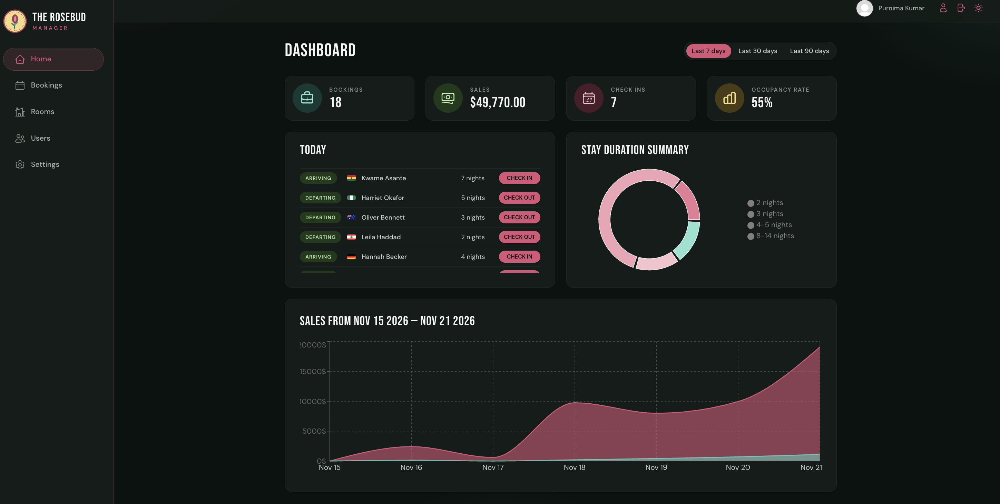
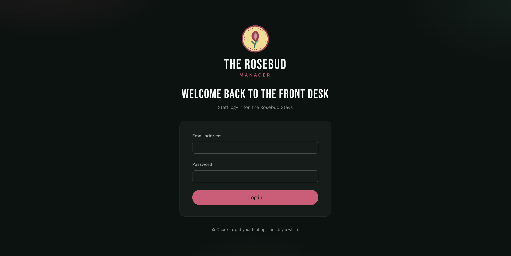
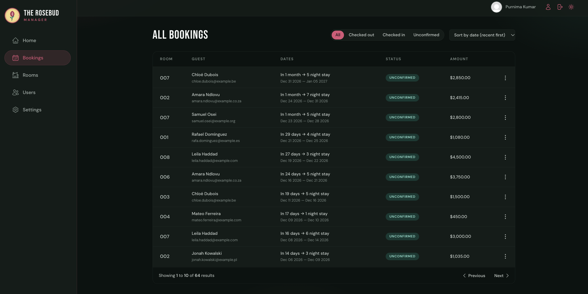
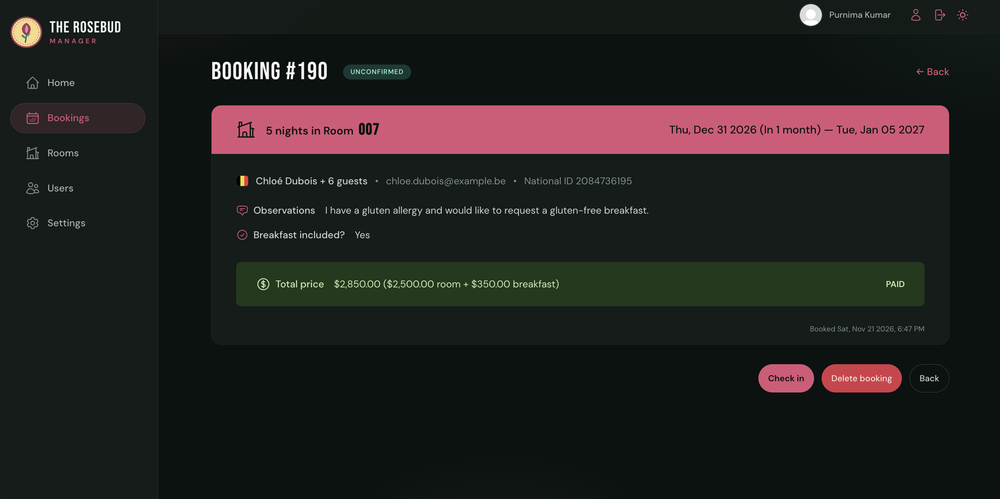
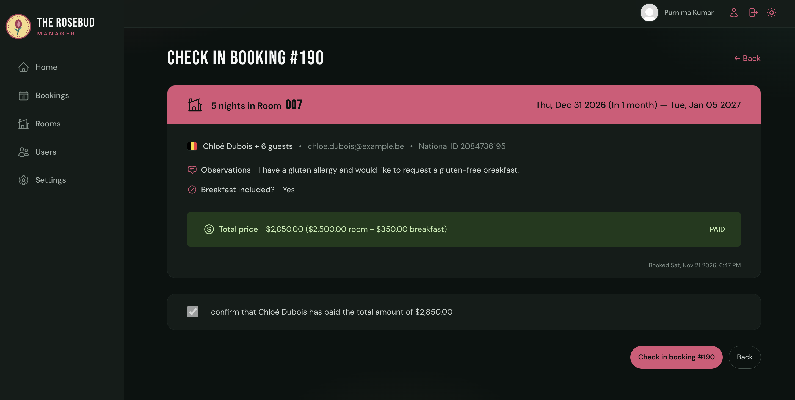
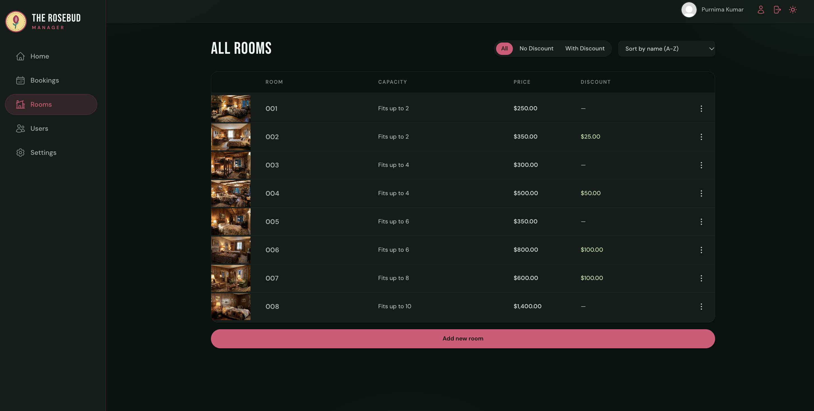
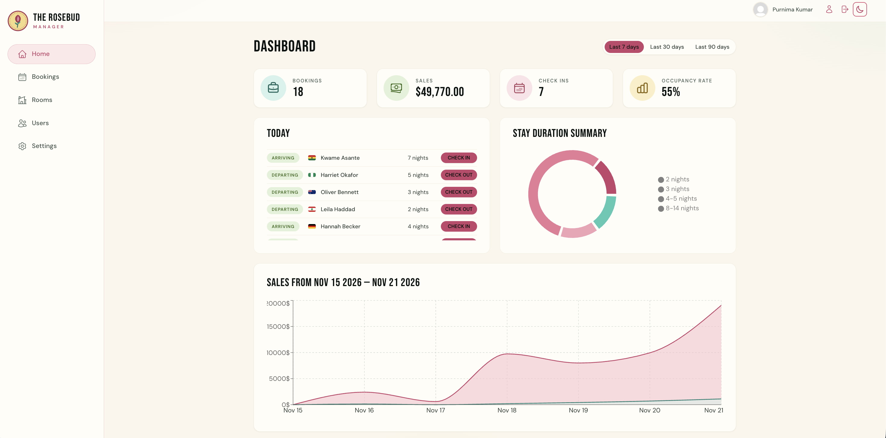

<p align="center">
  
</p>

<h1 align="center">The Rosebud Manager</h1>

<p align="center">
  The front desk for <a href="https://the-rosebud-stays.vercel.app/">The Rosebud Stays</a>,
  a small-town motel inspired by the Rosebud Motel from <em>Schitt's Creek</em>.<br />
  Staff use it to manage rooms, bookings, check-ins and settings.
</p>



## Two apps, one motel

The Rosebud is split into two apps that share one Supabase backend:

| App                                                        | Who it's for | What it does                                                               |
| ---------------------------------------------------------- | ------------ | -------------------------------------------------------------------------- |
| [The Rosebud Stays](https://the-rosebud-stays.vercel.app/) | Guests       | Browse the 8 rooms, check availability and book a stay                     |
| [The Rosebud Manager](https://rosebud-manager.vercel.app/) | Motel staff  | Run the front desk: bookings, check-in/out, rooms, pricing, staff accounts |

A booking made on the guest site shows up here right away, ready to be checked in.

## Features

- **Dashboard:** bookings, sales, check-ins and occupancy for the last 7, 30 or 90 days, plus a sales chart, a stay-length breakdown and today's arrivals and departures with one-click check-in/out.
- **Bookings:** filter by status, sort by date or amount, paginate, and open any booking for the full guest and payment details.
- **Check-in:** confirm payment and optionally add breakfast. The price comes from the motel's settings and is multiplied by nights and guests.
- **Rooms:** create, edit, duplicate and delete rooms, with photo upload, capacity, pricing and discounts.
- **Settings:** min/max nights per booking, max guests and breakfast price.
- **Staff accounts:** existing staff create new staff accounts. Everyone can update their name, avatar and password.
- **Dark and light themes:** dark is the default, to match the guest site.

## Screenshots

| Login                                | Bookings                                   |
| ------------------------------------ | ------------------------------------------ |
|  |  |

| Booking details                                         | Check-in                                  |
| ------------------------------------------------------- | ----------------------------------------- |
|  |  |

| Rooms                                | Light mode                                                       |
| ------------------------------------ | ---------------------------------------------------------------- |
|  |  |

## Interesting bits

### Staff-only access that users can't grant themselves

Because the guest site and the manager share a Supabase project, "is signed in" isn't enough to see guest data.

- **Staff role:** staff accounts carry `app_metadata.role = "staff"`. Only the service-role key can write `app_metadata`, so no user can make themselves staff.
- **Route guard:** [`ProtectedRoute`](src/ui/ProtectedRoute.jsx) checks for the staff role.
- **Creating staff:** new accounts are made by a Supabase Edge Function that first checks the caller is staff. This means public sign-ups can stay disabled, and an admin's session never gets swapped for the new user's (a known side effect of calling `signUp` from the browser).

### The URL holds the table state

Filter, sort and page live in the URL (`/bookings?status=checked-in&sortBy=totalPrice-desc&page=2`), so any view can be bookmarked or shared.

- **Validation:** the params are checked against allow-lists, so a hand-edited URL can't break the query. A page past the end redirects to the last page.
- **Prefetching:** the next and previous pages are fetched in the background, so paging feels instant.

## Getting started

```bash
npm install
cp .env.example .env   # add VITE_SUPABASE_URL and VITE_SUPABASE_KEY (the public anon key)
npm run dev
```

## Credits

A fan-made project, not affiliated with or endorsed by _Schitt's Creek_ or its creators.

Created by Purnima Kumar · [@purnimakumarr](https://github.com/purnimakumarr)
